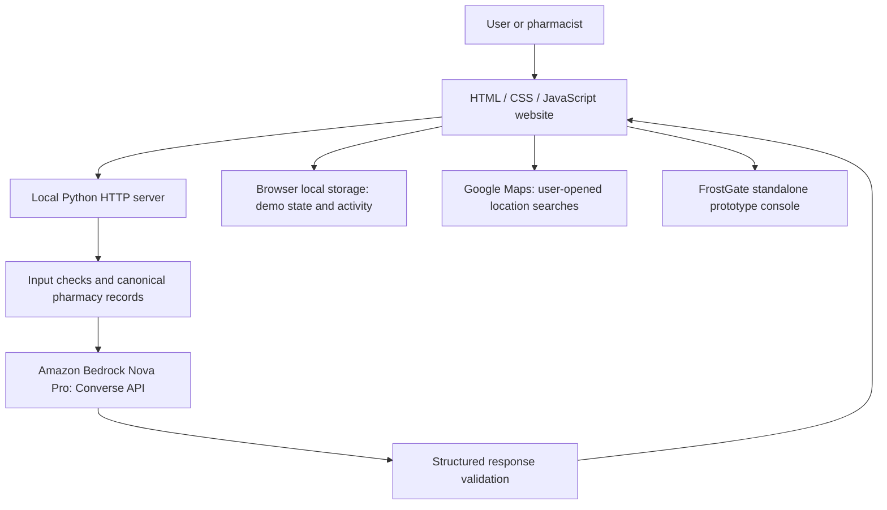

# ColdChain Guardian

### Keep medicine continuity in view when the power goes out.

**A SpartHill Hackathon project for the AWS track**, combining a community medicine finder, a pharmacist’s emergency workspace, and **Guardian AI powered by Amazon Bedrock Nova Pro**.

When a pharmacy loses power, its team needs to understand the affected equipment, review temperature-sensitive stock, identify a possible receiving pharmacy, and coordinate the next steps. ColdChain Guardian brings those decisions into one interface while keeping the pharmacist responsible for verification and approval.

> **Prototype status:** The website runs locally with a Python backend. Bedrock chatbot inference has been verified with a configured AWS session. Pharmacy records, stock, contact details, power status, distances, travel times, and equipment holdover values are synthetic or modeled. This is a hackathon demonstration, not a validated clinical system or live emergency directory.

## The problem we chose

The hackathon challenge asks builders to help someone keep an essential service running when a crisis disrupts food, medicine, or information.

Our essential-service operator is **the pharmacist**. During an outage, finding the closest building is only part of the problem. A receiving facility also needs power, suitable storage conditions, enough space, and an agreement to accept the medicines. Inventory review, monitored transport, and a documented handover matter as well.

ColdChain Guardian explores how AI can make the available information easier to use without pretending that incomplete records establish medicine safety.

## The idea

The application connects two perspectives:

- **User:** Find possible medicine sources in the shared pharmacy network by service area, medicine, stock, and reported power.
- **Pharmacist:** Review equipment and affected stock, investigate storage partners, follow emergency options, and record a simulated transfer.

Guardian AI answers medical and pharmacy-continuity questions. For nearest-pharmacy questions, its answer is grounded in the same named pharmacy records used elsewhere on the website.

## A sample outage scenario

Mission Community Pharmacy loses power. The pharmacist opens the overview and sees the demo equipment inventory, four coolers, and the last manually recorded refrigerator reading. They review the affected stock and ask:

> “Which is the nearest powered pharmacy in the website network? Give its distance, driving time, and power details.”

From the default **Mission District** demo service area, the application identifies **Castro Health Pharmacy**, with a modeled distance of **1.6 miles** and an assumed driving time of **10 minutes**. Nova Pro returns a structured decision, and the backend validates it against the ranked website records before displaying the answer.

The pharmacist still needs to confirm power, exact storage suitability, available volume, receiving acceptance, and transport arrangements. If the scenario becomes a citywide outage with no receiving location, the emergency page offers a link to **Hayden’s FrostGate** prototype console for contingency assessment.

These values demonstrate the workflow; they are not live observations or a recommendation to transfer real medicines.

## Explore the application

| Page | What it does |
| --- | --- |
| **Overview** | Shows the pharmacy’s demo equipment, cooler count, illustrative holdover durations, a nearest powered network pharmacy, and a location-entry workflow. |
| **User** | Searches 10 synthetic pharmacies across 10 service areas for four medicine examples; ranks powered, in-stock matches by modeled travel time. |
| **Incident planner** | Presents five emergency-response considerations: review stock and equipment, assess backup power, assess qualified portable cooling, investigate a receiving location, and review the FrostGate contingency. |
| **Inventory** | Shows three demo refrigerated product lines totaling 43 packages, with review status and storage-volume fields. |
| **Storage network** | Shows the shared pharmacy records, modeled distances, map links, receiving-capacity percentages, and separately entered available liters. |
| **Transfers** | Walks through simulated partner acceptance, preparation, departure, arrival, and handover. |
| **Incident log** | Records local demo activity and supports JSON export. |
| **Architecture** | Explains the local implementation, AI responsibilities, and proposed AWS deployment. |
| **FrostGate** | Opens the supplied standalone prototype console for a separate device/simulation experience. |
| **Guardian AI** | Provides a floating chatbot connected to the local Bedrock API. Successful model responses display model and AWS request metadata. |

The **User / Pharmacist** selector blurs and disables pages outside the selected presentation role. This is a demonstration interface behavior, not authentication or access control.

## Where Amazon Bedrock Nova Pro is used

Guardian AI uses the server-side **Amazon Bedrock Converse API**. The chatbot is configured in `server.py` to invoke:

```text
us.amazon.nova-pro-v1:0
```

The browser sends a question and relevant app context to `/api/chat`; AWS credentials remain on the server through the SDK credential provider chain.

### Nearest-pharmacy answers

The backend:

1. Loads canonical pharmacy names and records from `network.json`.
2. Uses the selected demo service area, defaulting to Mission District. Mentioning a supported service area in the question can override that selection.
3. Excludes sites marked without power or unavailable. Client reports may further restrict a site’s availability.
4. Computes and ranks the same modeled routes used by the website.
5. Supplies Nova Pro with the approved candidates and requests a structured JSON decision.
6. Validates the model’s selection against the first ranked eligible site and formats the answer using canonical record fields.

The model does not invent pharmacy names, contacts, or route measurements. A nearest **powered** network pharmacy is a possible place to investigate; it is not automatically a suitable or confirmed storage partner.

Examples to try:

```text
Which is the nearest powered pharmacy in the website network?
Which pharmacy is closest in Dogpatch?
What should I check before transferring refrigerated medicines during an outage?
What is an antibiotic?
```

The backend also includes `/api/plan` for structured logistics planning. Planning helpers remain in the source; the current incident-planner screen emphasizes the five emergency actions rather than exposing every earlier planning control.

### AI, rules, and human review

| Responsibility | Owner |
| --- | --- |
| Interpret a question and classify the request | Nova Pro |
| Produce general medical information or a structured operational decision | Nova Pro |
| Choose which canonical records may be considered | Application logic |
| Rank demo distances and validate a nearest selection | Application logic |
| Check response structure, allowed actions, and candidate IDs | Application guardrails |
| Confirm product requirements, real facility conditions, and receiving acceptance | Pharmacist |
| Approve any actual medicine movement or equipment use | Pharmacist |

This prototype uses application-level guardrails. It does **not** claim a deployed Amazon Bedrock Guardrails resource or authoritative clinical-reference retrieval.

## Location search: two distinct modes

### Website-network demo

The chatbot and overview can identify a nearest powered pharmacy from the website’s synthetic network. Distances are based on the selected demo service area, not device GPS. Unsupported real-world locations are not automatically geocoded into that network.

### Google Maps fallback

Enter an address, city, or ZIP code in the overview, or choose **Use my current location** and grant browser permission. The application builds Google Maps searches for nearby pharmacies and hospital pharmacies. Specific place names, real-world distances, and directions appear in Google Maps; the app does not scrape or import those results.

Entered locations and device coordinates remain in page memory until a search link is opened. Opening the link shares the search location with Google Maps. They are not saved or sent to Bedrock by this location workflow.

An optional `/api/nearest` integration with **Amazon Location Service** is implemented, but `geo-places:SearchNearby` was blocked by the development account’s AWS Organizations service control policy. Google Maps is therefore the active fallback. An authorized administrator must permit that API before enabling `amazon-location` in `dist/nearby.js`.

**Bedrock cannot detect a device’s physical location.** Browser geolocation supplies coordinates; a location service performs place lookup.

## FrostGate: the no-destination contingency

When the incident involves a citywide outage or no available nearby cooling equipment, the emergency page links to **FrostGate — Hayden’s Device**.

The included `dist/frostgate.html` is a separate prototype console. It opens in simulation, and its hardware controls and AI configuration are independent of Guardian AI’s backend connection. Embedded credential literals were removed from the supplied HTML.

The prototype does not establish validated temperature control, usable medicine holdover, or product viability. Real device use requires product-specific verification, validated equipment procedures, monitoring, and pharmacist oversight. Opening the console does not activate hardware.

## Architecture



### Technology stack

- **Frontend:** HTML, CSS, and plain JavaScript; no frontend build step.
- **Backend:** Python standard-library HTTP server.
- **AWS SDK:** Boto3.
- **AI:** Amazon Bedrock Nova Pro through the Converse API.
- **Demo data:** Canonical JSON records and frontend scenario data.
- **Local persistence:** Browser local storage for operational demo state.
- **Directions:** Google Maps links.
- **Checks:** Python `unittest` and Node.js scripts.

## Run locally

### Prerequisites

- Python **3.10 or newer** recommended, with `pip` and `venv`.
- An AWS account and server-side credentials permitted to invoke the selected Nova Pro inference profile, for live chatbot responses.
- Node.js only if you want to run the frontend checks.

### 1. Clone the project

```bash
git clone https://github.com/ShradDeb/SpartHillHackathon-ColdChainGuardian.git
cd SpartHillHackathon-ColdChainGuardian
```

### 2. Install the Python dependencies

```bash
python3 -m venv .venv
source .venv/bin/activate
python -m pip install -r requirements.txt
```

On Windows, activate the environment with `.venv\Scripts\Activate.ps1` in PowerShell.

### 3. Configure the AWS environment

Use your organization’s approved AWS CLI sign-in, SSO, profile, or other supported SDK credential method. Workshop registration is not a requirement for the code itself; valid AWS credentials and model permissions are required for live inference.

For a configured named profile, a macOS/Linux shell example is:

```bash
export AWS_PROFILE=your-configured-profile
export AWS_REGION=us-east-1
export AWS_DEFAULT_REGION=us-east-1
export BEDROCK_MODEL_ID=us.amazon.nova-pro-v1:0
```

Omit `AWS_PROFILE` if you intentionally use another SDK credential provider. The model environment variable is required by runtime checks and used by the planning endpoint; `/api/chat` explicitly selects the Nova Pro profile shown above.

Do not put AWS keys in HTML, JavaScript, Git commits, or chat messages. No credentials or local authentication caches are included in this repository. Temporary sessions may expire and need renewal.

### 4. Start the app

```bash
python server.py
```

Open **http://127.0.0.1:4180/#dashboard**.

To choose another port:

```bash
PORT=4187 python server.py
```

The server binds to loopback for local development. Without valid AWS configuration, the interface can still display demo workflows, but live AI requests cannot succeed. `/api/status` reports configuration presence; only a successful inference request verifies actual model access.

## API overview

| Method | Endpoint | Purpose |
| --- | --- | --- |
| `GET` | `/api/status` | Reports SDK configuration presence, region, and model settings. |
| `POST` | `/api/chat` | Invokes Nova Pro for Guardian AI, then validates and formats the response. |
| `POST` | `/api/plan` | Generates a structured logistics plan using eligible candidates. |
| `POST` | `/api/nearest` | Optional Amazon Location lookup and Bedrock explanation; requires separate AWS permissions. |

Provider failures and rejected outputs are shown as errors or guardrail responses rather than replaced with an unlabeled example answer.

## Guardrails and data handling

- Checks new questions and incident text for common identifiers and credential patterns before sending them to Bedrock.
- Does not send chatbot transcript history in the current request flow. This also prevents the assistant’s own fictional phone numbers from blocking follow-up questions.
- Rejects common attempts to override instructions or extract credentials.
- Restricts pharmacy recommendations to backend-approved canonical records.
- Validates structured outputs, approved action identifiers, response shape, and bounded response length.
- Answers medically relevant questions while redirecting unrelated topics; consequential personal medical decisions require clinician or pharmacist review.
- Does not authorize medicine usability, execute transfers, send messages, or activate hardware.
- Keeps AWS credentials outside browser code and returns request metadata for successful inference.

These checks are prototype controls, not guarantees of privacy, clinical accuracy, or resistance to all adversarial inputs. Do not enter patient information into the demo. Browser local storage is not an authenticated shared database or a production audit system.

### Storage eligibility

Receiving-capacity **percentages are not converted to liters**. The storage workflow requires reviewed inventory volume, a separately recorded available-liter capacity, reported availability, and a suitability flag before a site becomes an eligible demo candidate. Receiving acceptance and transfer steps are simulated.

Equipment holdover values and sample medicine storage labels are scenario data. They do not replace manufacturer instructions or validated operating procedures.

## Suggested hackathon demonstration

1. **Introduce the pharmacist:** An outage interrupts medication refrigeration at Mission Community Pharmacy.
2. **Open the overview:** Show equipment, coolers, and the nearest powered website-network example.
3. **Ask Guardian AI:** Use the nearest-pharmacy button and show the Nova Pro model identifier and AWS request ID in the answer.
4. **Explore the shared network:** Change the User page’s service area or selected medicine to show different demo matches.
5. **Review storage readiness:** Explain why reported power alone is insufficient and why available liters and suitability must be entered separately.
6. **Show the contingency:** Open the fifth emergency option and Hayden’s FrostGate simulation.
7. **Close the workflow:** Demonstrate a simulated transfer, local activity log, and the architecture page.

## Tests

From the repository root, with the Python environment activated:

```bash
python -m unittest discover -s tests -p 'test_*.py'
node tests/check-combined.cjs
node tests/check-nearby.cjs
```

The uploaded version includes **18 backend tests** plus frontend checks. Coverage includes canonical pharmacy filtering, storage eligibility, citywide exclusion, nearest-site validation, privacy follow-ups, response bounds, location-input validation, and Google Maps fallback behavior. Live Bedrock calls are separate integration checks and require AWS access.

## Repository guide

```text
.
├── server.py                 # Local website and JSON API server
├── guardrails.py             # Input checks, canonical ranking, output validation
├── nearby.py                 # Optional Amazon Location lookup
├── network.json              # Canonical synthetic pharmacy records
├── requirements.txt          # Boto3 dependency
├── dist/
│   ├── index.html            # Shared shell and navigation
│   ├── style.css             # ColdChain Guardian visual design
│   ├── app.js                # Overview, inventory, storage, transfers, local state
│   ├── community.js          # Medicine finder, demo areas and pharmacy data
│   ├── continuity.js         # Emergency options and planning helpers
│   ├── nearby.js             # Overview network card and location-entry workflow
│   ├── guardian-widget.js    # Floating Nova Pro chatbot
│   ├── roles.js / roles.css  # Presentation-role controls
│   ├── frostgate.html        # Standalone FrostGate prototype console
│   └── download.html         # Download-page interface
├── tests/                    # Backend and frontend checks
├── EDITING.md                # Source editing notes
├── GUARDRAILS.md             # Additional guardrail documentation
└── AWS-DEPLOYMENT-STATUS.md   # Hosting limitations and proposed deployment
```

Edit the source with Kiro, VS Code, or another text editor and refresh the browser. This repository contains editable source; the ZIP download binary is not part of the uploaded source files.

## Deployment and reliability status

The website is available as source on GitHub; it has **not been deployed to a public AWS application URL**.

During development, AWS organization policies blocked deployment operations for Lambda, API Gateway, CloudFormation, and EC2-related checks. No successful multi-Availability-Zone failover test is claimed.

A proposed production architecture is:

- Private S3 frontend assets served through CloudFront.
- API Gateway and Lambda for the application API.
- A least-privilege execution role for Bedrock access.
- Cognito for authenticated pharmacy access and DynamoDB for shared operational records.
- Request throttling, cost controls, monitoring, backups, and reliability tests before public use.

These are future deployment components, not infrastructure supplied or provisioned by this repository. The local Python development server should not be exposed directly as a public production API.

## What we would build next

- Verified pharmacy participation, live power status, storage capability, and receiving acceptance.
- Real location and routing integration with appropriate permissions and data-use terms.
- Product-specific manufacturer guidance retrieval with source attribution and evaluation.
- Authenticated pharmacist accounts, shared records, and durable custody/audit events.
- Validated sensor ingestion and equipment interfaces.
- Evaluations for medical responses, prompt injection, privacy filtering, and failure handling.
- Authorized AWS deployment followed by load, recovery, and reliability testing.
- Device validation before FrostGate is considered for any real medicine-storage workflow.

## Project origins and attribution

ColdChain Guardian combines the supplied **ColdChain Guardian v3** community medicine-finder concept and synthetic network with the **MedRelay** pharmacy-continuity workflows. The **FrostGate** console was supplied as Hayden’s separate prototype contribution.

The hackathon contribution is the cohesive workflow connecting community medicine access, pharmacy emergency operations, a constrained Nova Pro assistant, and an explicit no-destination contingency.
